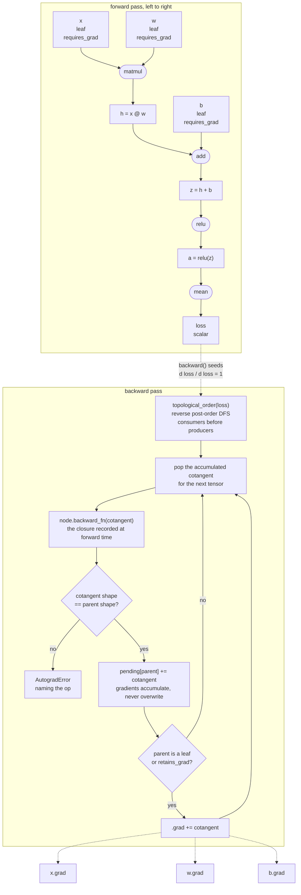

# Nabla

A deep learning framework built from first principles on NumPy: reverse-mode
automatic differentiation, layers, optimisers and a training loop, small enough
to read end to end in an afternoon.

[](https://github.com/Liona-orph/nabla/actions/workflows/ci.yml)
[](https://www.python.org/)
[](LICENSE)
[](https://mypy-lang.org/)
[](https://docs.astral.sh/ruff/)
[](https://numpy.org/)

Nabla exists because when a training run produces the wrong number, a framework
you can read is worth more than one you cannot. Every gradient in it is verified
against a central-difference numerical gradient in float64; the broadcast
reduction that hand-rolled engines usually get wrong is implemented once and
tested exhaustively; and the backward pass refuses to continue if any
vector-Jacobian product returns a cotangent whose shape does not match its
input.

## Quickstart

```bash
pip install -e ".[dev]"
```

```python
import nabla as nb
from nabla import data, nn, optim, train

g = nb.random.Generator(seed=0)
x, y = data.make_moons(1000, g)
loader = data.DataLoader(data.ArrayDataset(x, y), batch_size=32, shuffle=True, generator=g)

model = nn.Sequential(
    nn.Linear(2, 32, generator=g),
    nn.Tanh(),
    nn.Linear(32, 2, generator=g),
)
trainer = train.Trainer(
    model,
    optim.AdamW(model.parameters(), lr=0.02),
    nn.cross_entropy,
    metrics={"accuracy": train.accuracy},
)
history = trainer.fit(loader, epochs=20, verbose=False)
print(f"accuracy after 20 epochs: {history.last()['train_accuracy']:.3f}")

# Every gradient in the package is verifiable against a central difference.
report = nb.check_grad(lambda t: nb.softmax(t) * nb.tanh(t), nb.tensor([0.3, -1.2, 0.8]))
print(report)
```

That program, run as written:

```
accuracy after 20 epochs: 0.971
check_grad(<lambda>): matches within 4.624e-11 (tol 1.000e-06, 3 probe(s), eps 1.0e-06); worst at argument 0 of shape (3,), index (2,): analytic -0.331060683848, numerical -0.331060683895
```

## The tape

There is no separate tape object. Each non-leaf tensor holds a `Node` naming the
operation that produced it, the input tensors, and a closure that maps the
output's cotangent to the inputs' cotangents. The graph *is* the tensors, so it
is freed by refcounting when the loss goes out of scope, and there is no global
mutable state for two models in one process to fight over.



Three properties fall out of that picture and are worth stating explicitly:

- **Gradients accumulate.** `.grad` is added to, never replaced. It is the only
  behaviour that makes a tensor used twice come out right, and it is why a loop
  that forgets `zero_grad` silently sums every step it has ever taken.
- **Buffers are read-only.** A vjp closes over the forward values it needs. If a
  caller mutated one afterwards, `backward()` would compute the exact gradient
  of a function that was never evaluated, silently. NumPy raises instead.
- **The graph is never freed.** Calling `backward()` twice walks the same tape
  again and accumulates twice, which is what the arithmetic says should happen.
  The cost is that intermediates stay alive until the output tensor is dropped.

`ARCHITECTURE.md` has the details, including the protocol an operation must
implement and a worked example of adding one.

## What is in it

| Area | What | Where |
| ---- | ---- | ----- |
| Autodiff | `Tensor`, `Node`, `backward`, functional `grad`, `no_grad`, `retain_grad` | `nabla.tensor`, `nabla.grad` |
| Correctness | `check_grad`: central differences in float64 against a random output projection | `nabla.grad` |
| Operations | 41 differentiable functions over 36 recorded primitives - arithmetic, reductions, shape, matmul, activations | `nabla.ops` |
| Broadcasting | one `unbroadcast`, used by every elementwise vjp and by `matmul` | `nabla.tensor` |
| Randomness | explicit seeded `Generator` with `spawn`; no global stream anywhere | `nabla.random` |
| Modules | `Module` with explicit registration, `state_dict`, `train`/`eval`, tree `__repr__` with parameter counts | `nabla.nn.module` |
| Layers | `Linear`, `Embedding`, `LayerNorm`, `RMSNorm`, `Dropout`, `Sequential`, `ModuleList`, `ModuleDict` | `nabla.nn.layers` |
| Attention | `MultiHeadAttention` with causal masking, `TransformerBlock` (pre-norm) | `nabla.nn.attention` |
| Initialisers | Xavier, Kaiming, truncated normal, with the fan-in/fan-out reasoning and variance tests | `nabla.nn.init` |
| Losses | `mse`, `cross_entropy`, `binary_cross_entropy`, `nll` - all from logits, all stable | `nabla.nn.loss` |
| Optimisers | `SGD` (momentum, Nesterov, decay), `Adam`, `AdamW`, `RMSProp`, each with `state_dict` | `nabla.optim` |
| Schedules | constant, step, cosine with warmup, linear warmup-decay - pure functions of the step | `nabla.optim.schedule` |
| Data | `Dataset` protocol, `ArrayDataset`, `Subset`, `random_split`, seeded `DataLoader` | `nabla.data` |
| Training | `Trainer` with clipping, schedules, metrics, early stopping; pickle-free checkpoints | `nabla.train` |
| Tests | 655 passing, 3 skipped, including every layer's gradients under `check_grad` | `tests/`, docstrings |

## Measured results

Every number below was produced by running the command next to it on one CPU
core, Python 3.10.12, NumPy 2.2.6. The full transcripts are in each example's
README.

| Example | Command | Result | Time |
| ------- | ------- | ------ | ---- |
| [Two moons](examples/mlp_moons/) | `python examples/mlp_moons/train.py` | 96.25% test accuracy, 1,218 parameters | 0.44 s |
| [Digits](examples/mnist_style/) | `python examples/mnist_style/train.py` | 95.60% test accuracy on 10 classes, 16,522 parameters | 1.2 s |
| [Char transformer](examples/char_transformer/) | `python examples/char_transformer/train.py` | validation loss 4.1271 -> 1.6631 nats/char (2.3994 bits/char), 420,926 parameters | 91.4 s |

The transformer's output after 91 seconds of training, verbatim:

```
Shall I compare thee
Steel the strengrows lov'st stry sarvely hearves fair,
That seem there leaving, and of to flreeds,
When hom thou wilts thy give my lives graces desert.
I recay do with with thou art confends,
Thou did have change than bouns of sun love that remook;
```

and before training, from the same architecture and the same sampler:

```
SUF'W.gecycMi;GpyWKFGgc-!)yTgcggBU)S,gh:hybygAg'K:Tg rg-cNyrg'H
```

## What this is not

An honest list of what you give up. None of these is a bug report; all of them
are decisions with reasons, recorded in `docs/adr/`.

- **No GPU.** NumPy on the CPU, single-threaded except for whatever BLAS does
  underneath. There is no device abstraction and adding one would touch every
  operation.
- **No fused kernels.** Every operation allocates its output. `LayerNorm` is six
  tape nodes where a fused implementation is one; attention materialises the
  full `(batch, heads, time, time)` score matrix and its cotangent, which at the
  transformer example's batch 32, 4 heads and 64 timesteps is 2 MiB per block
  per direction, and at 1,024 timesteps would be 512 MiB.
- **No higher-order derivatives.** A vjp is written in NumPy, not in Nabla ops,
  so the backward pass is not itself differentiable. No `grad(grad(f))`, no
  Hessian-vector products, no MAML.
- **No `einsum`.** An autodiff `einsum` means parsing the subscript grammar and
  rewriting each term's subscripts to produce its cotangent - a few hundred
  lines of index algebra whose failure mode is a silently transposed gradient.
  `matmul`, `permute` and `sum` compose to the same thing, legibly.
- **The graph is never freed.** `backward()` does not release the tape. Two
  calls accumulate twice, and intermediates live until the output tensor is
  dropped.
- **GELU is the tanh approximation.** NumPy has no vectorised `erf`, and
  `math.erf` is scalar, so the exact form would need a Python-level loop over
  every element. The tanh form stays within about 3e-4 of the exact function.
  Its gradient is the exact derivative *of the approximation*, so gradient
  checking still passes to float64 tolerance - but the forward value is
  knowingly inexact, and it is the only place in the package where that is true.
- **No convolutions, no recurrence, no batch normalisation, no distributed
  anything.** The layer set is what a transformer and an MLP need.

### And it is slower than writing the NumPy by hand

By a measured amount. `benchmarks/overhead.py` writes the same three-layer MLP
twice - once with gradients derived on paper and coded directly, once out of
`nn.Linear` - asserts that the two agree to float32 precision, and times both:

```
configuration                                  numpy       nabla     ratio
small  (batch 32, 784-128-128-10)            0.109ms     0.244ms     2.22x
large  (batch 512, 784-1024-1024-10)        14.721ms    17.570ms     1.19x

fastest of 5 alternating blocks of 40 steps, after 20 warmup steps; gradients asserted equal first
```

The ratio is not a constant, which is the useful part. The overhead per
operation is roughly fixed - a `Node`, a closure, a dictionary entry, a
topological sort - so it is a large fraction of a small matmul and a small
fraction of a large one. At batch 32 with 128 hidden units the tape costs 2.2x;
at batch 512 with 1,024 hidden units it costs 1.19x, because by then the machine
is doing real arithmetic and the bookkeeping has not grown.

Anyone quoting "the cost of the framework" as a single number without saying at
what size is not telling you anything. Across six consecutive runs on the same
machine the small configuration measured 2.21x, 2.30x, 2.34x, 2.28x, 2.29x and
2.34x, and the large one 1.20x, 1.20x, 1.20x, 1.19x, 1.19x and 1.19x - a spread
of about 3% and 1%. The absolute times over those same six runs drifted by 10%
as the machine's other tenants came and went, which is why the benchmark
alternates blocks of the two implementations and takes the minimum: the ratio is
the measurement, and the ratio holds still.

## Development

```bash
make help        # every target, with a description
make install     # pip install -e ".[dev]"
make test        # pytest -q, including the doctests in src/
make lint        # ruff check + ruff format --check
make fmt         # ruff format + ruff check --fix
make typecheck   # mypy --strict src
make examples    # run all three examples
make ci          # everything CI runs, in the same order
```

The checks that have to stay green are `ruff check .`, `ruff format --check .`,
`mypy --strict src` and `pytest -q`. `pytest` runs the doctests in `src/nabla`
as well as `tests/`, so a stale example in a docstring is a build failure.

## Documentation

- [`ARCHITECTURE.md`](ARCHITECTURE.md) - the tape, the vjp protocol, broadcast
  reduction, the dtype policy, and a worked example of adding an operation.
- [`docs/adr/`](docs/adr/) - the six decisions that shape everything else, in
  Nygard format.
- [`CONTRIBUTING.md`](CONTRIBUTING.md) - what a pull request needs.

## Licence

Apache 2.0. See [`LICENSE`](LICENSE).
